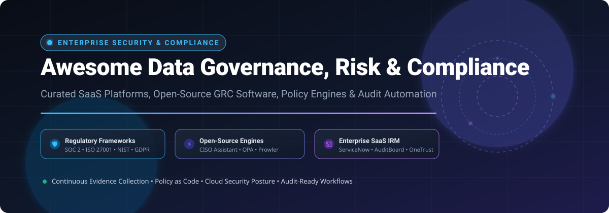

  

# 🛡️ Awesome Data Governance, Risk & Compliance (GRC)

  
  
  
  
  
  
  

---

## 📌 Overview & Ecosystem Architecture

> Curated index of leading **Enterprise SaaS GRC Platforms**, **Open-Source Compliance Engines**, **Policy-as-Code Frameworks**, and **Audit Automation Tools**.  
> *Targeting Enterprise Risk Management (ERM), Integrated Risk Management (IRM), Cloud Security Posture, and Continuous Evidence Collection across SOC 2, ISO 27001, NIST CSF, HIPAA, GDPR, and PCI-DSS.*

This repository tracks notable **SaaS platforms** and **open-source projects** for **Data Governance, Risk & Compliance (GRC)**. These tools empower security engineers, compliance officers, risk managers, and auditors to centralize risk registers, codify security controls, streamline vendor risk assessments, and maintain continuous audit-ready compliance postures.

---

## 📑 Table of Contents
- [📊 Sector Overview & Market Dynamics](#-sector-overview--market-dynamics)
- [🏢 Enterprise SaaS & Hosted Platforms](#-enterprise-saas--hosted-platforms)
- [⚡ Open-Source GitHub Projects](#-open-source-github-projects)
- [📈 Star History](#-star-history)
- [🤝 How to Contribute](#-how-to-contribute)
- [💖 Support & Sponsorship](#-support--sponsorship)
- [⚠️ Disclaimer](#️-disclaimer)

---

## 📊 Sector Overview & Market Dynamics

The global Governance, Risk, and Compliance (GRC) market is valued at approximately **$40B–$50B in 2024/2025** and is projected to expand beyond **$80B–$115B+ by 2030**, exhibiting a robust compound annual growth rate (**CAGR of ~10% to 14%**). 

The sector is **moderately to highly fragmented** rather than a winner-take-all monopoly: while mega-cap platform providers (e.g., ServiceNow, MetricStream, Archer, Diligent) capture multi-billion-dollar enterprise suites, specialized sub-sectors—including AI compliance automation (Vanta, Drata), privacy engineering (OneTrust), and open-source policy-as-code engines (OPA, Trivy, CISO Assistant)—foster continuous competitive disruption and active private equity consolidation.

---

## 🏢 Enterprise SaaS & Hosted Platforms

| Product | Company Size (Valuation / Revenue) | Starting Pricing Tier | Free Tier / Trial Limits | Description |
|---|---|---|---|---|
| **[ServiceNow GRC (IRM)](https://www.servicenow.com/)** | **~$159B–$219B market cap** (~$11.0B–$13.3B annual revenue) | **$125.00/operator/month** (Standard IRM bundle; Professional at $250/mo, Enterprise at $375/mo, Lite operators at ~$75/mo) | **Free Personal Developer Instance (PDI)** provided indefinitely via ServiceNow Developer Program (sandbox for development/testing; requires periodic login to prevent hibernation/reclamation) | Enterprise Integrated Risk Management (IRM) covering audit, risk, policy, and compliance applications across large enterprise environments. |
| **[Diligent HighBond](https://www.diligent.com/)** | **~$4B–$7B valuation** (Insight Partners / Clearlake / Blackstone; ~$200M+ ARR) | **$5,000.00/year** (Diligent One base platform listing on Capterra) | **14-day free trial** for specific AI/GovernAI modules; **30-day free trial** for ACL Analytics; core platform requires guided sales PoC | GRC platform with Enterprise Risk Management, Audit Management, and Vendor Risk modules tracking KPIs, KRIs, and KCIs. |
| **[OneTrust GRC](https://www.onetrust.com/)** | **$4.5B valuation** (~$500M+ ARR) | **$827.00/month** (entry single-domain CMP/Governance module; enterprise annual contracts typically start at $10,000/year) | **14-day free trial** (scoped PoC with limited admin seats, restricted test inventory/records, and DAUV traffic limits) | Privacy, third-party risk, and trust intelligence GRC platform featuring automated compliance assessments and data mapping. |
| **[AuditBoard](https://www.auditboard.com/)** | **$3.0B valuation** (acquired by Hg in 2024; ~$200M+ ARR) | **$20,000.00/year** (starting baseline tier; median contract spend ~$45,947/year on Vendr) | **Sales-guided Proof of Concept (PoC) only**; no self-service free trial or permanent free tier | Category leader for internal audit, SOX compliance, and controls management with automated workflows and audit trails. |
| **[Druva GRC](https://www.druva.com/)** | **$2.0B valuation** (~$200M+ ARR) | **$8.00/month** (entry listing on Software Advice/Capterra; data protection tiers scale by protected workloads/capacity) | **30-day free trial** (up to 60 days upon tenant evaluation extension; full feature access without upfront credit card) | Governance, risk, and compliance capabilities within Druva's cloud data protection platform focused on data resilience and information governance. |
| **[RSA Archer (Archer IRM)](https://www.archerirm.com/)** | **~$1.38B valuation** (Cinven acquisition; ~$220M annual revenue) | **$671.31/month** (single monthly subscription license via CDW-G list) | **15-day free trial** for select Archer Exchange utility add-ons; core platform requires vendor-led guided demo/PoC | Fixture in banking, insurance, and highly regulated sectors requiring deep, auditable integrated risk management across 7 solution areas. |
| **[Riskonnect](https://www.riskonnect.com/)** | **~$1.0B+ enterprise valuation** (TA Associates / Thoma Bravo; ~$150M–$250M+ ARR) | **$900.00/user/year** (entry ERM 250-user band tier; $75.00/user/month equivalent) | **Sales-guided Proof of Concept (PoC) only**; no self-service free trial or permanent free tier | Enterprise risk management and integrated risk platform (IRM) spanning ERM, claims management, and third-party risk. |
| **[MetricStream](https://www.metricstream.com/)** | **~$480M valuation** (Clearlake Capital / Blue Torch Capital; ~$100M+ ARR) | **$75,000.00/year** (entry small-enterprise deployment floor per SelectHub benchmarks; ~$6,250.00/month equivalent) | **Custom sales-led sandbox evaluation only**; no self-service free trial or permanent free tier | Enterprise GRC suite for large regulated organizations covering enterprise risk, CyberGRC, and regulatory compliance. |
| **[LogicGate](https://www.logicgate.com/)** | **~$160M+ valuation** (backed by PSG; ~$49M–$59M ARR) | **$13,000.00/year** (entry application tier; median spend ~$52,600/year on Vendr; ~$1,083.33/month equivalent) | **Sales-guided Proof of Concept (PoC) only**; no self-service free trial or permanent free tier | Mid-market GRC built on the Risk Cloud no-code workflow builder for custom risk assessments and compliance processes. |
| **[LogicManager](https://www.logicmanager.com/)** | **~$10M–$20M valuation** (bootstrapped/profitable; ~$6.3M–$7.7M annual revenue) | **$10,000.00/year** (entry package tier; value-based Jobs-to-be-Done pricing including unlimited users) | **90-day unconditional satisfaction guarantee** with guided trial onboarding; no permanent free tier | ERM and GRC software offering fixed all-inclusive Jobs-to-be-Done pricing with unlimited user seats and dedicated analyst support. |

---

## ⚡ Open-Source GitHub Projects

*Ranked strictly by GitHub Star Count (descending).*

| Project | GitHub Stars | Description | Core Capabilities & Architecture |
|---|---|---|---|
| **[Trivy](https://github.com/aquasecurity/trivy)** |  | Comprehensive security and compliance scanner for containers, Kubernetes, code repositories, and clouds. | Automated compliance scanning against CIS Benchmarks, NSA, and custom security standards; SBOM generation and vulnerability management. |
| **[Prowler](https://github.com/prowler-cloud/prowler)** |  | Open-source security assessment, auditing, and compliance hardening tool for AWS, Azure, GCP, and Kubernetes. | Continuous posture assessment mapped to CIS Benchmarks, NIST 800-53, ISO 27001, PCI-DSS, GDPR, and HIPAA. |
| **[Open Policy Agent (OPA)](https://github.com/open-policy-agent/opa)** |  | Open-source, general-purpose policy engine that unifies policy enforcement across the cloud-native stack. | Declarative Policy-as-Code using Rego; decodes compliance boundaries into executable tests across microservices, Kubernetes, and CI/CD pipelines. |
| **[Steampipe](https://github.com/turbot/steampipe)** |  | The extensible SQL workbench for cloud infrastructure, compliance evidence gathering, and security auditing. | Query cloud resources and APIs directly with SQL; suite of open compliance mods covering SOC 2, NIST, CIS, HIPAA, and ISO 27001. |
| **[DefectDojo](https://github.com/DefectDojo/django-DefectDojo)** |  | Leading open-source application vulnerability correlation and security orchestration platform (OWASP project). | Consolidates security findings, coordinates penetration tests, deduplicates vulnerabilities, and maps remediation to compliance frameworks. |
| **[CISO Assistant](https://github.com/intuitem/ciso-assistant-community)** |  | Microservices-based, AI-native open-source GRC platform. Community Edition self-hosted via Docker. | Over 30+ preloaded frameworks (ISO 27001, NIST CSF, SOC 2, NIS2); reusable control objects, multi-tenant risk registers, and MCP / API integration. |
| **[ComplianceAsCode](https://github.com/ComplianceAsCode/content)** |  | Automated security compliance content and remediation baselines for Linux, containers, and hypervisors. | Production-grade SCAP, Ansible, and Bash compliance automation content aligned with DISA STIG, CIS, and USGCB benchmarks. |
| **[Probo](https://github.com/getprobo/probo)** |  | Open-source, AI-native GRC platform tailored for software engineering and security operations teams. | Full GRC lifecycle platform with CLI (`prb`), GraphQL API, and Model Context Protocol (MCP) integrations for automated agentic compliance. |
| **[Ansible Lockdown (RHEL8-CIS)](https://github.com/ansible-lockdown/RHEL8-CIS)** |  | Production-ready Ansible automation role for CIS benchmark compliance and operating system hardening. | Automated compliance auditing and remediation tasks matching Center for Internet Security (CIS) benchmark baselines. |
| **[GovReady-Q](https://github.com/GovReady/govready-q)** |  | Open-source compliance automation engine and questionnaire platform for DevSecOps and FISMA/FedRAMP. | Automated System Security Plan (SSP) authoring, self-assessment workflows, and fast compliance authorization tooling. |
| **[MITRE SAF CLI](https://github.com/mitre/saf)** |  | Command-line interface for the MITRE Security Automation Framework (SAF) streamling security data pipelines. | Normalizes vulnerability, attestation, and compliance results across disparate tools into standardized Heimdall and InSpec schemas. |
| **[OpenGRC](https://github.com/LeeMangold/OpenGRC)** |  | Streamlined, self-hosted GRC platform built for small-to-midsize security operations teams. | Core risk registers, control assessments, vendor risk tracking, and audit workflows mapped across ISO 27001, SOC 2, and NIST. |
| **[SimpleRisk](https://github.com/simplerisk/simplerisk)** |  | Intuitive open-source risk management platform trusted by enterprise and public sector organizations. | Streamlined risk identification, risk evaluation, mitigation planning, and audit compliance logging without heavy overhead. |
| **[Eramba (Docker)](https://github.com/eramba/docker)** |  | Dedicated Docker distribution and deployment environment for Eramba Open GRC software. | Production container deployment for Eramba's evidence management, multi-framework control mapping, and internal audit engine. |
| **[Auditree Framework](https://github.com/ComplianceAsCode/auditree-framework)** |  | GitOps-driven compliance automation framework that validates controls via automated Python tests. | Continuous compliance validation; executes compliance assertions as unit tests and records evidence directly into version-controlled Git trees. |

---

## 📈 Star History

---

## 🤝 How to Contribute

Contributions are warmly welcomed! Help make this ecosystem directory comprehensive and up-to-date:

1. **Fork** the repository.
2. **Add or refine** entries in `README.md` (keep descriptions factual, include official URLs, and adhere to table formatting).
3. **Validate** links, pricing data, or star badges.
4. **Submit a Pull Request** with a concise explanation of your additions or edits.

---

## 💖 Support & Sponsorship

If you find this curated GRC and compliance directory valuable, consider showing your support:

- ⭐ **Star** this repository to help others discover it.
- 🍴 **Fork** and share it with your security, engineering, and compliance teams.
- ☕ **Sponsor or buy a coffee**: Support ongoing curation and maintenance via the **[GitHub Sponsors Dashboard](https://github.com/sponsors/ishandutta2007)**.

Thank you to all contributors and security champions helping make compliance open, automated, and audit-ready!

---

## ⚠️ Disclaimer

- This repository is a **community-curated educational resource** — inclusion does not imply an official endorsement or legal compliance guarantee.
- GRC platforms handle sensitive audit evidence, vulnerability records, and regulatory documentation; ensure your deployment enforces strict role-based access control (RBAC), immutable logging, encryption at rest and in transit, and adherence to relevant privacy laws (GDPR, CCPA, HIPAA).
- Pricing figures, valuations, and contract tiers are benchmarked from publicly available disclosures, procurement databases (e.g., Vendr, SelectHub, Capterra, G-Cloud), and company announcements; actual quotes vary based on enterprise modules, user bands, and custom terms. Always validate control mappings and evidence quality directly with your certified auditor before relying on any tool for certification.

---

  <b>Built for compliance officers, risk managers, internal auditors, and platform engineers.</b> 
  <i>Let's make data governance, risk, and compliance more open, automated, and audit-ready.</i>

